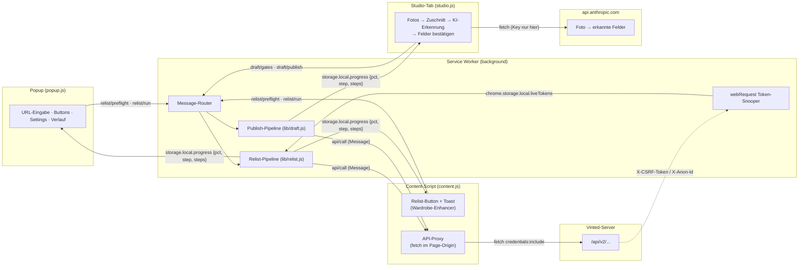
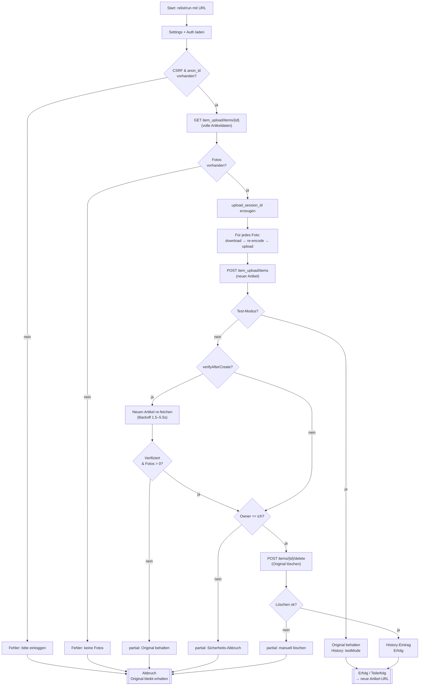
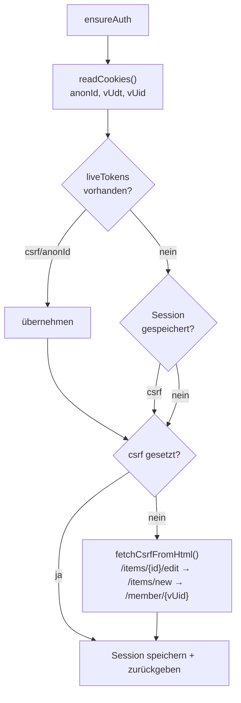
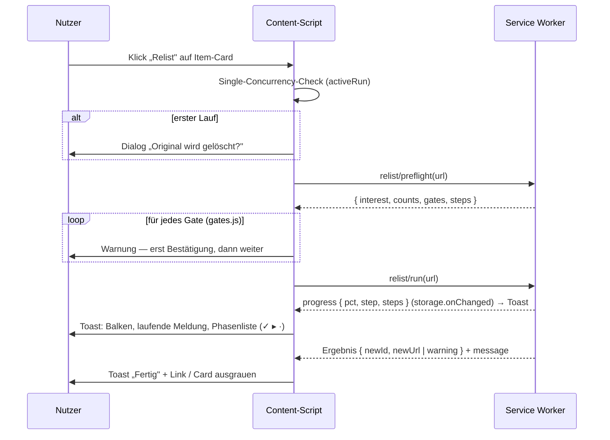

# Ablaufdiagramme — Vinted Relist

Diese Datei beschreibt die zentralen Abläufe der Extension. Die Diagramme sind in
[Mermaid](https://mermaid.js.org/) geschrieben (rendern auf GitHub automatisch); für
die Haupt-Pipeline gibt es zusätzlich eine ASCII-Variante.

---

## 1. Komponenten-Überblick

In welchem Kontext läuft welcher Code und wie kommunizieren sie.



**Kernidee:** Der Service Worker orchestriert, **fetcht aber nie selbst** gegen die
state-changing API. Jeder API-Call wird als `api/call`-Nachricht an das Content-Script
geschickt und dort ausgeführt — nur so stimmt der `Origin` (`https://www.vinted.de`),
den Vintends CSRF-Schutz verlangt.

**Zweite Kernidee (ADR-0007):** Vom Auto-Listing überquert nur die **schreibende** Hälfte
diese Naht. Zuschnitt, KI-Call und Feldbestätigung bleiben im Studio-Tab — der Worker
bekommt einen Aufruf und gibt eine Antwort, statt minutenlang zu leben. Die Originalfotos
und der entschlüsselte Anthropic-Key verlassen den Tab nie.

---

## 2. Relist-Pipeline (Hauptablauf)



### ASCII-Variante (kompakt)

```
relist/run(url)
   │
   ├─ getSettings()  +  ensureAuth(domain, itemId)
   │      └─ kein CSRF/anonId? ─────────────────────────► Fehler (Original bleibt)
   │
   ├─ [10%]  fetchItemViaPage           GET  /api/v2/item_upload/items/{id}
   │      └─ keine Fotos? ─────────────────────────────► Fehler
   │
   ├─ uploadSessionId = uuidV4()
   │
   ├─ [20–75%]  je Foto (sequentiell, mit Jitter):
   │      download (CDN) → reencode (OffscreenCanvas) → uploadPhotoViaPage
   │                                    POST /api/v2/photos  (+ photo[temp_uuid])
   │
   ├─ [80%]  createItemViaPage          POST /api/v2/item_upload/items
   │
   ├─ Test-Modus?  ── ja ──► Original behalten, History(testMode) ─► Erfolg
   │
   ├─ [88%]  verifyAfterCreate?  ── ja ──► re-fetch new item (Backoff 1.5/2.5/4/5.5s)
   │              └─ nicht verifizierbar / 0 Fotos ────► partial (Original bleibt)
   │
   ├─ [92%]  Ownership-Check (vUid == seller_id?)
   │              └─ Mismatch ─────────────────────────► partial (Sicherheits-Abbruch)
   │
   ├─ deleteItemViaPage                 POST /api/v2/items/{id}/delete
   │              └─ Fehler ───────────────────────────► partial (manuell löschen)
   │
   └─ [100%]  History-Eintrag (Erfolg) ─────────────────► Erfolg → neue Artikel-URL
```

**Sicherheitsprinzip:** *create-then-delete*. Der Klon wird immer **zuerst** erstellt
(und optional verifiziert), das Original erst **danach** gelöscht. Bricht irgendetwas
ab, behält der Nutzer sein Original — schlimmstenfalls gibt es kurz zwei Listings.

---

## 3. CSRF-/Auth-Beschaffung (`ensureAuth`)



`liveTokens` werden passiv vom **webRequest-Snooper** befüllt: jedes Mal wenn die
Vinted-SPA selbst einen API-Call macht, liest die Extension dessen `X-CSRF-Token` und
`X-Anon-Id` aus den Request-Headern. Das ist die zuverlässigste Quelle, weil sie exakt
der aktiven Session entspricht.

---

## 4. On-Page „Relist"-Button (Content-Script)



Die Warnungen formuliert das Content-Script nicht selbst: `preflight` liefert die
geordneten `gates`, und dieselbe Liste bekommt das Popup (`lib/gates.js`) — sonst driften
zwei Textfassungen auseinander. Die `steps` reisen aus demselben Grund mit: das
Content-Script ist ein klassisches Skript und kann `lib/steps.js` nicht importieren
(ADR-0006).

---

## 5. Storage-Schlüssel (chrome.storage.local)

| Key              | Beschreibung                                              | Erzeuger            |
|------------------|-----------------------------------------------------------|---------------------|
| `liveTokens`     | `{ [domain]: {csrf, anonId, ts} }` — gesnoopte Tokens     | webRequest-Snooper  |
| `sessions`       | `{ [domain]: {csrf, anonId, vUdt, vUid, ts} }`            | auth.js             |
| `settings`       | Nutzer-Einstellungen (siehe settings.js)                  | popup / settings.js |
| `relistHistory`  | Array der letzten ≤100 Läufe                              | history.js          |
| `progress`       | `{ pct, step, steps, ts }` — Fortschritt + Phasenliste    | progress.js, steps.js |
| `log`            | Ring-Buffer der letzten 500 Log-Zeilen                    | logger.js           |
| `confirmedDelete`| Flag: Erst-Bestätigung Löschen erledigt                   | confirmation.js     |
| `confirmedCreate`| Flag: Erst-Bestätigung Anlegen erledigt                   | confirmation.js     |
| `taxonomy`       | Kategorie-/Größen-Cache mit TTL                           | taxonomy.js         |
| `priceMemory`    | gemerkte Preise je Kategorie                              | price-memory.js     |
| `anthropicKey`   | verschlüsselter API-Key                                   | secret.js           |

Dazu in `chrome.storage.**session**`: `anthropicKeyPlain` — der entsperrte Key, nur für
die Dauer der Browser-Sitzung.
